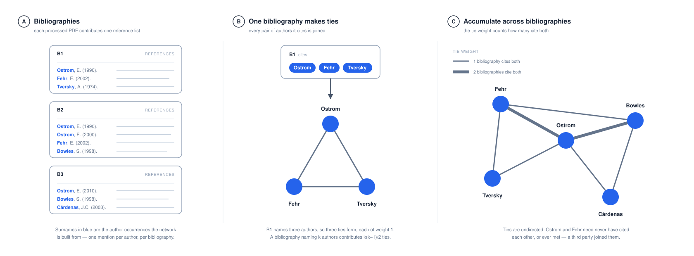
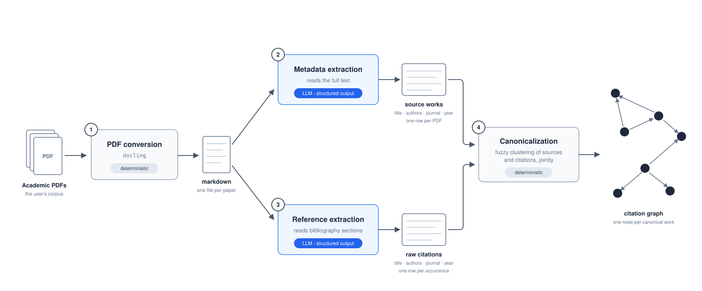

# citegraph

Turn a folder of academic PDFs into a citation graph you can query, and then
ask who the literature reads together.

`citegraph` is for a researcher who has a corpus of papers — a literature
review, a field's working papers, a lab's output — and wants to study it
bibliometrically without hand-coding bibliographies. It converts each PDF to
text locally, has a large language model extract the paper's metadata and its
full reference list, resolves every bibliographic record into one canonical
**work**, and clusters author names across the corpus into canonical
**authors**. On top of those tables it builds the author co-citation network
and offers a test for whether a documented relationship between two people
shows up in how the field cites them.

Everything lands as plain CSVs in one output directory, every stage is
checkpointed, and nothing is sent anywhere until you have seen a cost estimate.

## What you get

Two questions, answered from the same output directory.

**What does this corpus cite?** `works.csv` holds every bibliographic record,
your own PDFs at `ring` 0 and everything they cite at `ring` 1, and
`citation_graph.csv` holds the work-to-work edges. A citation of one of your
own papers resolves to that same work, so the graph includes your papers citing
each other. `authors.csv` and `author_citations.csv` do the same for people.

**Who is read together?** `CitationGraph.author_cocitation_network()` builds
the author co-citation projection (Small 1973; White & Griffith 1981): two
authors are joined when the same bibliography cites both. It is a genuine
one-mode network on which degree, betweenness and eigenvector centrality are
defined. `tie_cocitation_test()` then asks whether a documented tie — doctoral
supervision, co-authorship, a shared institution — is co-cited more than a
comparable pair of strangers, against a null that holds each author's
prominence fixed.

## What you need

- **Python 3.11 or newer.**
- **A Google Gemini API key.** The extraction stages call Gemini and nothing
  else; there is no offline or alternative-provider path yet. Set
  `GOOGLE_API_KEY` in the environment or in a `.env` file. The default model
  is a lite tier; `citegraph estimate` prints the token count and dollar cost
  for your corpus before any call is made, and the pipeline asks for
  confirmation.
- **Disk and patience for the PDF extra.** PDF conversion uses
  [`docling`](https://github.com/DS4SD/docling), which pulls in a large machine
  learning stack. Install it once in a fresh virtual environment.
- **Optionally, an OpenAlex API key** (`OPENALEX_API_KEY`, free from
  openalex.org) if you want DOIs and author identifiers from CrossRef and
  OpenAlex. Without it the enrichment stage still works but hits a small daily
  budget.

What leaves your computer:

| Stage | Service | Data sent externally |
| --- | --- | --- |
| PDF conversion | Docling, local | None by citegraph; Docling may download model files |
| Metadata extraction | Google Gemini | A bounded portion of each paper's converted text |
| Reference extraction | Google Gemini | The detected bibliography section, or the full text when none is found |
| Canonicalization, authors, co-citation | Local | None |
| Enrichment (optional) | CrossRef and OpenAlex | Extracted titles, authors, and query parameters |

Do not process confidential, embargoed or license-restricted documents until
their disclosure to those services has been approved.

## Install

```bash
pip install "citegraph[pdf]"           # PDF-to-graph pipeline
pip install "citegraph[all]"           # + CrossRef/OpenAlex enrichment, networkx, plots, Excel export
pip install citegraph                  # lightweight core for querying an existing output directory
```

The base install is enough to load a finished run with `CitationGraph`; the
`[pdf]` or `[all]` extra is required to start from PDFs. Install `[graph]` (or
`[all]`) for the co-citation network, which returns a `networkx` graph.

## Quickstart

Run it in stages. Each stage reads the previous one's artifacts from `--out`,
so you get an inspection point before every expensive step:

```bash
export GOOGLE_API_KEY="your-key-here"

citegraph convert ./pdfs --out ./out --ocr-auto   # local; writes out/markdown/
citegraph estimate --out ./out                    # tokens and USD, no API calls
citegraph metadata --out ./out                    # Gemini -> sources.csv
citegraph references --out ./out                  # Gemini -> citations_raw.csv
citegraph dedup --out ./out                       # -> works.csv, citation_graph.csv
citegraph enrich --out ./out --enrich-contact you@example.com   # optional
citegraph authors --out ./out                     # -> authors.csv, author_citations.csv
citegraph report --out ./out --open               # QC dashboard in the browser
```

Or in one go: `citegraph run ./pdfs --out ./out --ocr-auto --enrich --enrich-contact you@example.com`.
`run` and `references` print the cost estimate and wait for a `y`; pass
`--yes` to skip the prompt when scripting (with no TTY the prompt resolves to
"no" and the stage exits having done nothing).

The same from Python:

```python
from citegraph import Pipeline
from citegraph.enrich import EnrichConfig

pipe = Pipeline(
    pdf_dir="./pdfs",
    out_dir="./out",
    ocr="auto",
    enrich=True,
    enrich_config=EnrichConfig(contact_email="you@example.com"),
)
print(pipe.estimate_extraction_cost().format_summary())
result = pipe.run()

result.works        # canonical works (ring 0 = your PDFs)
result.graph        # (citing_id, cited_id) edges
```

Re-running skips work already done, so an interrupted run wastes no API calls.

### Try it without a key

A finished run ships in the repository under
[`examples/demo_out/`](examples/demo_out/): one experimental economist's 93
papers and everything they cite, as the five generated tables. From a checkout:

```bash
git clone https://github.com/yabramuvdi/citegraph && cd citegraph
pip install "citegraph[graph]"
citegraph report --out examples/demo_out --open
```

```python
from citegraph import CitationGraph

g = CitationGraph.from_out_dir("examples/demo_out")
g                                   # <CitationGraph: 93 core works, 3277 works, 4532 edges, 4738 authors>
g.top_cited(5)[["Title", "Year", "citation_count"]]
g.top_cited_authors(5)[["display_name", "n_citations_received"]]

G = g.author_cocitation_network(min_papers=3)
G["a-ostrom-elinor"]["a-cardenas-juan-camilo"]["weight"]   # 53 bibliographies cite both
```

Every example below runs against it.

## Using citegraph with an AI agent

The pipeline is deliberately shaped so a coding agent can drive it: every
stage is a command, every stage leaves artifacts a program can check, and
corrections live in curated files rather than in edits to generated ones.
Paste this into your agent's instructions, then describe your corpus and your
question.

> I want to analyse a folder of academic PDFs with the `citegraph` Python
> package (`pip install "citegraph[all]"`). Start by running `citegraph --help`
> and reading https://github.com/yabramuvdi/citegraph/blob/main/docs/USER_GUIDE.md.
>
> - Run the pipeline stage by stage: `convert`, `estimate`, `metadata`,
>   `references`, `dedup`, `enrich`, `authors`, `report`. Show me the output of
>   `citegraph estimate` and wait for my approval before any stage that calls
>   the LLM. Never pass `--yes` on your own.
> - API keys live in `.env`. Never read, print or copy them.
> - After every stage run `citegraph status` and check the output directory for
>   `conversion_warnings.json`, `*_failures.jsonl`, `source_duplicates.json`,
>   `papers_no_references.json` and `author_review.json`. Tell me what they say
>   before moving on.
> - Never edit `works.csv`, `authors.csv` or `citation_graph.csv` by hand: they
>   are regenerated. Corrections go in `author_aliases.csv`,
>   `author_external_ids.csv`, `journal_aliases.csv` or
>   `work_annotations.csv`, followed by re-running the stage that reads them.
> - Answer questions about the corpus with
>   `CitationGraph.from_out_dir(out_dir)` in Python rather than by parsing the
>   CSVs yourself. Report counts from `run_summary.json`, not estimates.
> - Processing a paper sends its text to an external LLM provider. Ask me before
>   processing anything confidential or embargoed.

## Analysing the corpus

### Querying the graph

`CitationGraph` is a small read-only view over the finished tables. Construct
it from a run's `out_dir` (the common case: extraction yesterday, questions
today) or from a freshly returned `PipelineResult`:

```python
from citegraph import CitationGraph

g = CitationGraph.from_out_dir("examples/demo_out")   # or "./out"
# or: g = CitationGraph.from_pipeline_result(pipe.run())

g                                  # <CitationGraph: 93 core works, 3277 works, 4532 edges, 4738 authors>
g.n_core_works, g.n_works, g.n_edges

g.core                             # your own papers (ring 0)
g.core_citations()                 # who among your papers cites whom
g.top_cited(n=10)                  # most-cited works (your own papers rank too)
g.citers_of("w-ostrom-1994-rules-games-and-common-pool-resources")   # 29 of the core papers
g.cited_by(g.core.index[0])                                           # one core paper's bibliography
```

When `authors.csv` and `author_citations.csv` exist, author-level queries
are available too. These join through `citation_graph.csv`, so source-paper
journal counts answer "which journals are doing the citing?":

```python
cardenas_id = g.find_author("cardenas").index[0]

g.top_authors(10, ring=0)                    # most prominent authors of YOUR papers
g.top_cited_authors(10)                      # most-cited authors in the corpus
g.citation_context_for_author(cardenas_id)   # one citing-work -> cited-work edge per row
g.citing_papers_by_author(cardenas_id)       # distinct source papers citing that author
g.source_journals_citing_author(cardenas_id) # source-paper journal rollup
```

`g.to_networkx()` exports the work-level graph as a `DiGraph` with edges
citing → cited (`pip install "citegraph[graph]"`).

### Author co-citation networks

`to_networkx()` exports the citation graph as it stands, which is one hop
deep: only works you processed a PDF for have outgoing edges. Path-based
centrality over that graph would rank the PDFs you happened to collect rather
than the literature.

`author_cocitation_network()` builds the standard alternative from
bibliometrics — the **author co-citation projection** (White & Griffith 1981;
White & McCain 1998, following Small 1973 on document co-citation). Two
authors are joined when the same bibliography cites both, and the tie weight
counts how many bibliographies do so.



```python
G = g.author_cocitation_network(min_papers=3)   # weighted, undirected networkx.Graph

ostrom_id = g.find_author("ostrom").index[0]
G.nodes[ostrom_id]["display_name"]              # also: n_citing_papers
G[ostrom_id][cardenas_id]["weight"]             # bibliographies citing both

import networkx as nx
nx.degree_centrality(G)                         # or betweenness, eigenvector, ...

# Self-citation robustness variant: drop this author's own papers
# from the citing side.
own = set(g.citing_papers_by_author(cardenas_id)["paper_id"])
G_ex = g.author_cocitation_network(min_papers=3, citing_ids=set(g.core.index) - own)
```

The ties are undirected and imply no contact between the authors — a third
party's reference list is what creates them. Two construction rules follow,
both drawn in
[`cocitation_projection.svg`](docs/figures/cocitation_projection.svg): a
citing work naming several works by one author still contributes a single
mention, and no author is ever joined to themselves. `min_papers` prunes the
long tail of once-cited names.
[`cocitation_why.svg`](docs/figures/cocitation_why.svg) contrasts the
projection with the work-level graph. Nodes are added in sorted order so a
seeded layout is reproducible; a `subgraph()` of it is not, so re-sort the
nodes before drawing a subset.

### Does a documented tie show up in the citation record?

You often know something about the people in a corpus that the bibliographies
do not say: who supervised whom, who shares a department, who co-authored.
`tie_cocitation_test` asks whether such a tie is visible in co-citation —
whether the two are cited together more than a *comparable* pair of strangers.

"Comparable" is the whole problem. Advisors and their students are prominent,
and prominent authors are co-cited with nearly everyone, so beating an average
pair proves nothing. The test therefore replaces each end of a tie with authors
cited by a similar number of bibliographies (`degree_tolerance`, a band around
each author's count), draws pairs from those strata, and reports where the tie's
observed count falls in that distribution.

Give it a `CitationGraph` and author-id pairs. A supervision table with
`advisor_author_id` and `advisee_author_id` columns is the natural input:

```python
import pandas as pd
from citegraph import CitationGraph
from citegraph.cocitation_stats import tie_cocitation_test

g = CitationGraph.from_out_dir("./out")
ties = pd.read_csv("supervision.csv")   # advisor_author_id, advisee_author_id

result = tie_cocitation_test(
    g,
    ties[["advisor_author_id", "advisee_author_id"]].itertuples(index=False, name=None),
    min_papers=3,                 # must match the network a companion figure draws
    exclude_self_citations=True,  # score on third-party bibliographies only
    n_draws=2000,
)

result.to_frame()                 # one row per tie: observed, null_median, p_value, pool_size, n_eligible
result.n_significant              # ties with p < alpha ...
result.expected_significant       # ... against how many chance alone would give
for tie in result.skipped:        # ties the data could not carry, with the reason
    print(tie.source, tie.target, tie.reason)
```

Three things to know before reporting the numbers:

- **`exclude_self_citations` defines a universe, not a filter on one side.**
  The bibliographies either member wrote are removed, and the tie *and* its
  comparison pairs are counted and prominence-matched inside what remains. The
  intuitive version, filtering only the tie, compares authors who lost most of
  their chances against authors who lost none.
- **Ties are usually not independent.** One advisor appears in several ties,
  so a combined p-value over the set is not confirmatory evidence. Report the
  per-tie permutation results, and `n_significant` against
  `expected_significant` as a description. `result.fisher_p_value` exists for
  the case where your ties really are independent.
- **Read `result.skipped` before claiming coverage.** A tie is skipped, with a
  reason, when an end is cited by fewer than `min_papers` bibliographies or has
  no degree-matched substitute. A skipped tie is not a null result.

Each tie seeds its own random generator from its own identity, so a tie's
numbers do not depend on the order ties arrive in or how many came with them.

## Reviewing a run

`citegraph report` writes a single self-contained `report.html` into the out
directory: stage progress, a problems summary, a per-paper table with expandable
metadata / reference / markdown previews, a dedup merge audit, enrichment match
quality, author-cluster review, and an artifact integrity check. It makes no
API or network calls and reads whatever artifacts exist, so it is designed to
be re-run after every stage — sections for stages you haven't run yet show a
placeholder with the command to run next.

```bash
citegraph report --out ./out          # write ./out/report.html
citegraph report --out ./out --open   # …and open it in your browser
```

`citegraph ui` serves the same information as a small local web app that
refreshes itself while a run is in progress. It is read-only, binds to
`127.0.0.1` only, and needs no extra dependencies. It is **experimental**: the
first slice of the researcher-facing application sketched in
[docs/UI_ARCHITECTURE.md](docs/UI_ARCHITECTURE.md), and its interface may
change.

```bash
citegraph ui --out ./out --open       # http://127.0.0.1:8765/ — Ctrl+C to stop
```

## Analysis helpers

These commands grew out of one manuscript and are general enough to ship, but
they are not the core offering and their interfaces may change between minor
versions.

### `export-authors`: one workbook for the authors of your own papers

`authors.csv` describes every author in the corpus, most of them met once in
somebody else's bibliography. `citegraph export-authors` narrows that to the
authors of your own PDFs and gathers everything known about them into a single
spreadsheet, keyed on `author_id` throughout:

```bash
citegraph export-authors --out ./out            # -> ./out/core_authors.xlsx
citegraph export-authors --out ./out --ring 1   # authors first met one hop out
```

| Sheet | Content |
| ----- | ------- |
| `README` | What each sheet is, its row count, and how many authors it covers |
| `Authors` | One row per author: identity, external ids, citation metrics, every raw spelling the corpus used, and co-citation centrality when `author_centrality.csv` is present |
| `Works` | One row per (author, work) — their cited works as well as your own |
| `Review_Flags` | The low-confidence clusters among them, from `author_review.json` |

Curated tables kept outside `out_dir` — hand-collected affiliations, career
histories, supervision ties — are added with `--extra-csv`, and
`--master-column` lifts a headline field onto the `Authors` sheet:

```bash
citegraph export-authors --out ./out \
  --extra-csv Careers=../careers.csv \
  --extra-csv Supervision=../supervision.csv \
  --master-column Careers=affiliation_institution
```

A row is kept when any column named `author_id`, or ending in `_author_id`,
names one of these authors — so an edge table survives when *either* end is
somebody you published, which is usually how supervision data is shaped. Each
added sheet also contributes an `in_<sheet>` flag to `Authors` and a coverage
count to `README`; hand-collected metadata rarely covers everybody, and seeing
who it misses is the point. Writing `.xlsx` needs `openpyxl`:
`pip install "citegraph[excel]"`.

### Hand-curated annotations

Facts a reviewer records about a work — a theme, a publication type — cannot
live in `works.csv`, which `dedup` regenerates. They go in
`work_annotations.csv` beside it, keyed on the work `id`, and
`CitationGraph.from_out_dir` joins them onto `works` at load, so
`g.core["Theme"]` just works. An optional `annotation_schema.csv`
(`column,type,allowed,description`) declares enum columns, which are validated
on load so a bad value fails naming the work instead of becoming a stray bar in
a figure. Ids that name no work raise rather than being dropped.

### JEL codes of your own papers

`citegraph jel` reads the JEL classification codes printed on each core paper's
title page back out of the converted markdown — no model or network calls — and
writes `jel_codes.csv` with one row per core paper:

```bash
citegraph jel --out ./out        # -> ./out/jel_codes.csv, and a list of papers without codes
```

| Column | Meaning |
| ------ | ------- |
| `JEL_Codes` | the codes, `;`-separated (`C93;D71;Q20`) |
| `JEL_General` | their general categories, the first letters (`C;D;Q`) |
| `JEL_Source` | `extracted` from the paper, `manual`, or `missing` |

Many working papers, chapters and dissertations print none. For those, add a
`JEL_Codes` column to `work_annotations.csv` and re-run; a hand-assigned value
overrides extraction. `citegraph.jel.JEL_GENERAL_CATEGORIES` maps each letter
to its name for plotting.

## Scanned PDFs

If some of your PDFs are scanned (each page is a bitmap with no selectable text),
use `ocr="auto"` to convert normally first and re-run only image-only outputs
with EasyOCR:

```python
pipe = Pipeline(pdf_dir="./pdfs", out_dir="./out", ocr="auto")
result = pipe.run()
```

Or with the CLI:

```bash
citegraph convert ./pdfs --out ./out --ocr-auto
citegraph run ./pdfs --out ./out --ocr-auto
```

Use `ocr=True` / `--ocr` when you want to force full-page OCR for every PDF.

After each conversion run `citegraph` writes a `conversion_warnings.json` sidecar
listing any markdown files that appear to be image-only (fewer than 200
substantive text characters after stripping image tags) or that lost too many
characters to a font docling could not map. If you see warnings there,
re-running with `--ocr-auto` is usually the fastest fix; `--ocr` is the
force-everything option.

## Cost estimate

`citegraph run` converts your PDFs to markdown first, then prints an estimated
token usage and dollar cost for the LLM extraction stages and waits for
confirmation before making any API calls. Pass `--yes` / `-y` to skip the
prompt.

To inspect the estimate without running the pipeline:

```bash
citegraph convert ./pdfs --out ./out      # produce markdown
citegraph estimate --out ./out            # report tokens / cost; no API calls
```

Or from the library:

```python
estimate = pipe.estimate_extraction_cost()
print(estimate.format_summary())
```

Files whose `metadata/<stem>.json` and `references/<stem>.json` caches already
exist are excluded from the totals. Pricing numbers are approximate standard
paid-tier Gemini rates, last checked 2026-09-04; the table lives in
[`src/citegraph/cost_estimation.py`](src/citegraph/cost_estimation.py) and
should be checked against https://ai.google.dev/gemini-api/docs/pricing before
trusting the output for budgeting.

## Real smoke test

For a new corpus, especially while tuning OCR, LLM concurrency, or enrichment,
prefer a staged smoke test over a single `run` command. This uses the same
checkpointed artifacts as the full pipeline, but gives you an inspection point
after every externally fragile step.

From a repository checkout, the maintained helper is:

```bash
ENRICH_CONTACT="you@example.com" scripts/smoke_test.sh /path/to/pdf-folder
```

Set `OUT_DIR`, `MODEL`, `LLM_CONCURRENCY`, `ENRICH_MAX_WORKERS`, or
`ENRICH_TIMEOUT` in the environment to override the defaults.

If you installed from PyPI, use the CLI directly. The expanded command sequence
is:

```bash
export PDF_DIR="/path/to/pdf-folder"
export OUT_DIR="/tmp/citegraph_smoke_out"

citegraph convert "$PDF_DIR" --out "$OUT_DIR" --recursive --ocr-auto --verbose
citegraph estimate --out "$OUT_DIR" --model gemini-3.1-flash-lite

citegraph metadata --out "$OUT_DIR" --model gemini-3.1-flash-lite --llm-concurrency 4
citegraph references --out "$OUT_DIR" --model gemini-3.1-flash-lite --llm-concurrency 4 --yes

citegraph dedup --out "$OUT_DIR"
citegraph enrich --out "$OUT_DIR" \
  --enrich-contact "you@example.com" \
  --enrich-max-workers 2 \
  --enrich-timeout 15
citegraph authors --out "$OUT_DIR"

citegraph status --out "$OUT_DIR"
```

Two details matter in practice:

- Keep `--ocr-auto` on the first pass unless you already know every PDF has
  selectable text. If conversion leaves `conversion_warnings.json`, inspect it
  before paying for LLM extraction.
- Use a real `--enrich-contact` and a modest `--enrich-max-workers` value when
  querying CrossRef/OpenAlex. This is slower, but friendlier to provider rate
  limits; re-runs reuse the per-work cache in `OUT_DIR/enrichment/`.

## Pipeline



After canonicalization, two optional stages complete the pipeline: CrossRef/OpenAlex
enrichment (DOIs and external author ids for every work) and author normalization
(`authors.csv` + `author_citations.csv`). A PDF version of the figure lives at
[docs/figures/pipeline.pdf](docs/figures/pipeline.pdf).

## Output schema

After a run, `out_dir/` contains the six CSVs below plus a few sidecar
files described at the end of this section. The per-stage caches live
under `markdown/`, `metadata/<stem>.json`,
`references/<stem>.json`, and (when enrichment runs)
`enrichment/` — safe to inspect, safe to delete to
force a re-extraction.

### `sources.csv` — one row per processed PDF (stage-2 checkpoint)

| Column | Type | Notes |
| ------ | ---- | ----- |
| `id` | string | `w-<surname>-<year>-<title-slug>`, deterministic across runs |
| `Title` | string | as extracted by the LLM |
| `Authors_List` | string | a Python list serialized via `repr`, e.g. `"['Jane Doe', 'John Smith']"` — round-trip with `ast.literal_eval` |
| `Authors` | string | derived `", ".join(Authors_List)`, ready for display |
| `Journal` | string | venue / publication |
| `Year` | int | publication year (`0` is the missing-value sentinel) |
| `source_file` | string | original PDF filename |

### `citations_raw.csv` — one row per *citation event* (before canonicalization)

Same columns as `sources.csv` minus `source_file` and `id`, plus:

| Column | Type | Notes |
| ------ | ---- | ----- |
| `citing_id` | string | the `w-…` id of the source work whose bibliography contained this citation |

A work cited by N papers appears N times here, with N different `citing_id`s.

### `works.csv` — canonical works, indexed by `id`

One row per canonical work: your own papers (ring 0) *and* everything they
cite, in one table. A citation that matches one of your own papers merges
into it rather than creating a separate row.

| Column | Type | Notes |
| ------ | ---- | ----- |
| `id` (index) | string | `w-<surname>-<year>-<title-slug>` |
| `ring` | int | discovery depth: `0` = your PDFs (the core), `1` = found in a ring-0 bibliography |
| `source_file` | string | original PDF filename; empty for works without full text |
| `Title`, `Authors`, `Journal`, `Year` | | from the first member of the cluster (full-text side wins) |
| `Journal_Canonical` | string | folded journal name to group on; `Journal` keeps the spelling the record used |
| `doi` | string | only after `--enrich`; `None` for unmatched rows |
| `enrichment_source` | string | only after `--enrich`; `"crossref"` or `"openalex"` |
| `enrichment_status` | string | only after `--enrich`; `"matched"` or `"miss"` |
| `enrichment_miss_reason` | string | only after `--enrich`; reason for unmatched rows, e.g. `"no_openalex_candidates"`, `"below_title_threshold"`, `"year_mismatch"`, `"author_mismatch"`, or `"http_error"` |
| `enrichment_title_score` | float | only after `--enrich`; raw fuzzy title score for the best accepted or rejected candidate |
| `enrichment_adjusted_score` | float | only after `--enrich`; title score after applying the year-mismatch penalty |
| `enrichment_candidate_title` | string | only after `--enrich`; external title that was accepted or explains the miss |
| `enrichment_year_match` | bool | only after `--enrich`; whether the input and candidate years agreed when both were known |
| `enrichment_year_delta` | int | only after `--enrich`; absolute year difference when both years were known |

`Authors_List` is preserved through canonicalization so author normalization can use structured author strings instead of comma-splitting display text. Enrichment (`--enrich`) writes the enriched copy to `enriched_works.csv` covering every ring — your core papers get DOIs and OpenAlex author ids too.

### `citation_graph.csv` — the actual graph

| Column | Type | Notes |
| ------ | ---- | ----- |
| `citing_id` | string | `w-…` (a work with full text) |
| `cited_id` | string | `w-…` (any work — including your own papers when cited within the corpus) |

### `authors.csv` — canonical authors, indexed by `id`

Produced by the author-normalization stage (`citegraph authors`, also part of
`citegraph run`). Sorted by `n_citations_received` (then `n_works`), descending.

| Column | Type | Notes |
| ------ | ---- | ----- |
| `id` (index) | string | `a-<surname>-<given>`, deterministic across runs |
| `display_name` | string | canonical human-readable name for the cluster |
| `surname` | string | as parsed from the best variant |
| `surname_norm` | string | diacritic-stripped surname used for blocking |
| `canonical_given` | string | longest full first name observed (or initials) |
| `initials` | string | canonical initials |
| `openalex_id` | string | OpenAlex author id when enrichment provided one |
| `orcid` | string | ORCID when enrichment provided one |
| `n_works` | int | distinct canonical works this author appears on |
| `n_core_works` | int | of those, how many are ring 0 (your own papers) |
| `n_citations_received` | int | citation edges into any of their works |
| `n_distinct_citing_works` | int | distinct works citing this author |

### `author_citations.csv` — one row per author occurrence

| Column | Type | Notes |
| ------ | ---- | ----- |
| `author_id` | string | the `a-…` cluster this occurrence was assigned to |
| `record_id` | string | the `w-…` work the name appeared on (join `works.ring` for the role) |
| `position` | int | author position on that work (0-based) |
| `raw_author` | string | the original author string before parsing |

### Curated files you may add beside the outputs

The generated CSVs are rebuilt by their stage; corrections go in these files,
which the stages read and apply last. Each fails loudly on an id that no longer
exists.

| File | Read by | Decides |
| ---- | ------- | ------- |
| `author_aliases.csv` (`cluster_id,canonical_id`) | `authors` | which author clusters are the same person |
| `author_external_ids.csv` (`author_id,openalex_id,orcid,note`) | `authors` | an author's identifier, outranking the provider's |
| `journal_aliases.csv` (`raw,canonical`) | `dedup`, `enrich` | journal abbreviations the automatic fold cannot match safely |
| `work_annotations.csv` (`id,…`) + `annotation_schema.csv` | `CitationGraph`, `jel` | anything a reviewer records about a work |

Low-confidence author clusters are flagged in `author_review.json`.

### Sidecar files

Most warning sidecar files follow the same convention: **absent means clean**.
They are created only when the condition they describe actually occurred, so
`path.exists()` is a sufficient check. Enrichment review files are different:
they are written when stage 5 runs so you can inspect match quality.

- `run_summary.json` — counts for the whole run: `n_works`, `n_core_works`, `n_citations_raw`, `n_edges`, `n_core_to_core_edges`, `n_self_loops_dropped`, `n_authors`, `n_author_citations`, `n_author_review_flags`, `n_metadata_failures`, `n_references_failures`, `n_source_duplicates`, `n_papers_no_references`, `n_conversion_warnings`, plus the model id and the dedup / author configuration.
- `artifact_manifest.json` — written by `citegraph run`: package version, stage, artifact paths, and the configuration used. Archive it with the CSVs for provenance.
- `metadata_failures.jsonl` and `references_failures.jsonl` — one JSON line per failed paper: `{source_file, stage, error_class, error_message}`. The pipeline keeps going past per-paper failures; re-running will retry them (their caches were not written).
- `source_duplicates.json` — written when two differently-named PDFs contain the same paper (detected by the same fuzzy-match logic used for reference deduplication). Each entry names the canonical source file, the duplicate file(s), and the paper title. The duplicate PDFs are silently skipped in the references stage; remove them from `pdf_dir` and re-run to clean up.
- `papers_no_references.json` — written when a paper is successfully processed but the LLM returned an empty reference list. Each entry has `paper_id`, `source_file`, and `title`. Common causes: image-only PDFs (see `--ocr-auto` / `--ocr`), papers with no bibliography section, or the model returning an empty list despite the content being present.
- `conversion_warnings.json` — written after stage 1 when any output markdown appears to be image-only or glyph-corrupted. Each entry has `source_file` and a human-readable `reason`. Re-run stage 1 with `--ocr-auto` to regenerate only the flagged files with OCR, or `--ocr` to force OCR for every PDF.
- `journal_alias_warnings.json` — written by `dedup` when a `journal_aliases.csv` row matches nothing *yet* because enrichment has not run; once every vocabulary exists a dead row raises instead.
- `enrichment_summary.json` — written by stage 5 when enrichment runs. Contains match/miss counts, source counts, match rate, and the `EnrichConfig` values used.
- `enrichment_misses.csv` — written by stage 5 when enrichment runs. Lists unmatched references with their miss reason so they can be inspected or curated later.
- `author_review.json` — written by the authors stage when a cluster looks low-confidence (initial-only name with several citations and no external id, a possible uncorroborated compound surname, or a detected corporate author). Inspect the flagged clusters and record decisions in `author_aliases.csv`.

## Evaluation

A small gold standard lives in [`evaluation/gold/`](evaluation/gold/). Run

```bash
python evaluation/evaluate.py --gold evaluation/gold --out ./out
```

to get metadata field-level accuracy, reference recall/precision, and
deduplication F1. The numbers in
[`evaluation/RESULTS.md`](evaluation/RESULTS.md) come from the synthetic
sample shipped with the repository and only confirm the harness is wired; they
are not a measurement of accuracy on a real corpus. Hand-label a few papers
from your own corpus before trusting any extraction rate.

## Configuration

`Pipeline(...)` arguments:

| Argument | Default | Meaning |
| -------- | ------- | ------- |
| `pdf_dir` | required | folder of input PDFs (`None` is allowed when resuming from a previous run's cache) |
| `out_dir` | required | where outputs and checkpoints are written |
| `model` | `gemini-3.1-flash-lite` | Gemini model id (or set `CITEGRAPH_MODEL`) |
| `enrich` | `False` | run a CrossRef/OpenAlex pass over the deduplicated references (requires the `[crossref]` or `[all]` extra) |
| `enrich_config` | `EnrichConfig()` | tune the enrichment pass — see below |
| `dedup_config` | `DedupConfig()` | tune the fuzzy dedup — see below |
| `author_config` | `AuthorClusterConfig()` | tune author clustering — see below |
| `llm_concurrency` | `4` | maximum concurrent Gemini extraction calls for metadata/references (or set `CITEGRAPH_LLM_CONCURRENCY`). CLI flag on LLM stages: `--llm-concurrency` |
| `overwrite_markdown` | `False` | re-run docling even when a cached `.md` exists (PDF conversion requires the `[pdf]` or `[all]` extra) |
| `recursive` | `False` | walk subdirectories of `pdf_dir`. Cache filenames are disambiguated by relative path (e.g. `journal_X/foo.pdf` → `journal_X__foo.md`); a clear error is raised if two PDFs would still collide. CLI flag: `--recursive` / `-r` |
| `ocr` | `False` | OCR mode: `False` disables OCR, `"auto"` retries image-only outputs with OCR, and `True` forces full-page OCR for every PDF. CLI flags: `--ocr-auto` / `--ocr` |

Dedup is tuned through `DedupConfig`:

```python
from citegraph import Pipeline
from citegraph.dedup import DedupConfig

pipe = Pipeline(
    pdf_dir="./pdfs",
    out_dir="./out",
    dedup_config=DedupConfig(
        threshold=85.0,        # similarity threshold (0-100)
        title_weight=0.7,
        authors_weight=0.3,
        journal_weight=0.0,
        year_window=1,         # max year difference for a match
    ),
)
```

Enrichment is tuned through `EnrichConfig`:

```python
from citegraph.enrich import EnrichConfig

pipe = Pipeline(
    pdf_dir="./pdfs",
    out_dir="./out",
    enrich=True,
    enrich_config=EnrichConfig(
        contact_email="you@example.com",  # CrossRef polite-pool User-Agent
        title_match_threshold=90.0,
        timeout_s=15.0,
        rows=3,                           # API result rows to consider
        max_workers=8,                    # concurrent enrichment workers
        year_mismatch_penalty=8.0,         # subtract when candidate year differs
        retry_attempts=3,                  # retry transient 429/503/timeouts
        retry_wait_s=0.25,                 # exponential-backoff base wait
    ),
)
```

Author clustering is tuned through `AuthorClusterConfig`:

```python
from citegraph.authors import AuthorClusterConfig

pipe = Pipeline(
    pdf_dir="./pdfs",
    out_dir="./out",
    author_config=AuthorClusterConfig(
        merge_mode="strict",   # precision-first (default); "loose" collapses
                               # by (surname, first-initial) regardless
    ),
)
```

On the CLI: `citegraph authors --merge-mode strict|loose`, plus `--aliases`
to point at a hand-curated `cluster_id,canonical_id` override CSV (defaults
to `<out>/author_aliases.csv` when it exists).

The CLI exposes the same knobs as flags — see `citegraph run --help`.

When enrichment runs, every row gets explicit diagnostics in
`enriched_works.csv`: `enrichment_status`, `enrichment_miss_reason`,
`enrichment_title_score`, `enrichment_adjusted_score`,
`enrichment_candidate_title`, `enrichment_year_match`, and
`enrichment_year_delta`. The same run writes `enrichment_summary.json` and
`enrichment_misses.csv` under `out_dir/` for quick review. The enrichment CLI
flags mirror these knobs: `--enrich-year-penalty`,
`--enrich-retry-attempts`, `--enrich-retry-wait`, and
`--enrich-max-workers`.

## Documentation

- [User guide](docs/USER_GUIDE.md) — staged tutorial, quality-control
  checkpoints, output interpretation, privacy, costs, troubleshooting, and how
  to correct and rerun.
- [Quickstart notebook](examples/quickstart.ipynb) — runnable tour of both
  pipeline modes, the cost estimator, dedup and enrichment review, author
  normalization, and the graph queries.
- [UI and application architecture](docs/UI_ARCHITECTURE.md) — proposed
  boundary for a future researcher-facing interface.
- [Release checklist](docs/RELEASE.md) — packaging and publishing procedure.
- [Changelog](CHANGELOG.md) — release changes, migration, and known limitations.

## Development

```bash
pip install -e ".[dev]"
pytest
ruff check .
```

CI runs the same lint + test commands on Python 3.11 / 3.12 / 3.13; see
[.github/workflows/ci.yml](.github/workflows/ci.yml).

## Releasing

The release workflow ([.github/workflows/publish.yml](.github/workflows/publish.yml))
uses PyPI's [trusted publishing](https://docs.pypi.org/trusted-publishers/),
so no API token is stored in the repo. See [docs/RELEASE.md](docs/RELEASE.md)
for the full checklist. To cut a release:

1. Update the version and changelog as described in [docs/RELEASE.md](docs/RELEASE.md).
2. Commit and push to `main`.
3. `git tag v0.2.0 && git push origin v0.2.0` — the workflow then builds an
   sdist + wheel and publishes them to PyPI.

To dry-run against TestPyPI first, build locally and upload manually:

```bash
python -m build
python -m twine upload --repository testpypi dist/*
```

## License

MIT — see [LICENSE](LICENSE).
